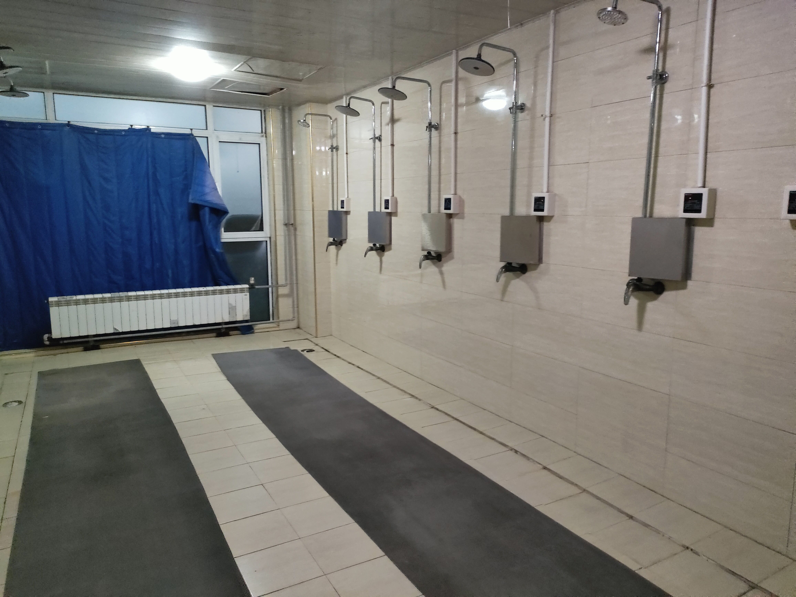

怎么讲呢
开学一个周了
在青软的基地里，这个条件生怕我被拐到缅甸去之后适应不了

当地的物价也高一个周大概花费了300

在这个环境不适合读书，我也没带，8人间，处处都是人根本静不下心

没招了

这个周尝试GPT代充直接被咸鱼制裁了永久封号，还在申诉中

推特的帖子因为咸鱼封号小暴了一下

还有啥事，我想想

这个周参加了我人生中第一次面试，不对应该是第二次，上一次是正方体教育的培训集团副总老师面的，当了一个学期的老师👨🏻‍🏫
怎么说呢这次面试，还没去呢，感觉阳气就要被吸干了。
给我面试的两个哥都挺好说话的，问的都是很基础的问题，比如vue的间距的这个
都是很简单的

什么都没有准备，准备准备肯定能过，哎呀，不过是体验一下哈哈哈哈。
没招了

应该没有别的事情了

奥对，昨天第一次做无人车，新奇的体验
比人开的慢，所以显得稳一些，但是容易急刹车

奥对也不能说是一点书也没看，看了一点 那个叫雷欧的男人决定去死

差不多了，不写了

食堂的饭真难吃，只能去吃路边摊了