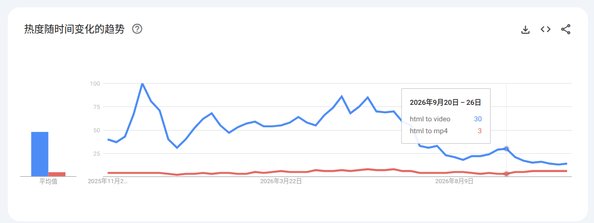

作为了一个**首席自嗨式编程专家**，每次都把一个产品不断打磨直至完美在考虑上线，甚至不干上线，更可气的是发出去后下载量为0，甚至不如在𝕏上发片下载量多。

不只这样，还在为从哪里找需求抓耳挠腮，到处留意，导出问，都这样了，找到的需求都是伪需求，辛辛苦苦开发好几个月，不过是给 Github 增加服务器压力，占用人家的硬盘。

自从我认真了读了[独元殇](https://www.ccgxk.com/)的博客了解过出海这个东西，就彻底改变了我找需求的方式，通过哥飞的方法论，我知道有办法可以直达需求，做过产品的人都知道，把东西做出来是最简单的，把它卖出去才是最关键的，做出的产品无法触达用户就是扯蛋。

出海是直接找到有需求，有流量的词，这样把产品做出来，才能触达用户，进而获取金钱。不用为了流量发愁。

出海是以一个极低的成本验证需求的方式。

我从三天前的下午做了我的第一个站，因为秋招无望，有了一些时间。

今天打开 Google Search Console（GSC），数据让我非常惊喜：仅仅 72 小时，Google 已经为我的新站编入了 5 个索引页面，并且在公网真实搜索中直接拿到了曝光，平均排名冲到了第 39 名（第 4 页）！

记录下这 3 天的实战全过程、踩过的坑以及背后的思考。

---

第一次做出海工具站，还是看到了一些效果，不枉我好几年的瞎折腾

## 先记一下时间点

- **11月5日 15:19** 找新词，根据哥飞的文章通过Sitemap，筛选了四个工具类的新词
- **11月5日 15:30** 评估 KGR，因为是让AI评估的，他给我估算的月搜索量，从这里就出错了（我现在开始写复盘的时候才发现的，靠，运气比较好，没有影响最终的计算结果）
- **11月5日 15:42** 确认选词 
- **11月5日 16:18** 注册域名（8.2$ 不含手续费）
- **11月5日 16:40** 上线单页
- **11月5日 16:48** SEO，提交GSC 与bing的，在GitHub上创建外链
- **11月5日 19:22** 调研竞品，确认功能范围和定价
- **11月6日 10:01** 确认技术方案，开始开发
- **11月7日 15:56** 完成整体开发（包括支付）
- **11月9日 22:00** Google平均排名冲到了第 39 名（第 4 页）

**费用**: 55(域名: 8.2$) + 16(开发所使用的token费) = 71

喔对，我的站： [HTML2Video](https://html2video.app)

---

我还自己去Google 趋势看我选的词，但是只看到一个热度，看不到具体的值。

> **热度的计算方式**：特定时间段内的搜索热度，以 0 到 100 的相对比例值显示。其中，值为 100 表示图表所示时间段内的热度峰值，值为 50 表示热度是峰值的一半，值为 0 表示数据不足。

这就导致热度不能作为参考

中途尝试了多款收款工具最终选定了 waffo.ai，门槛低，审批时间短。
推荐Stripe 但是Stripe申请复杂且有申请费用，遂放弃。

---

整个的技术方案放到 cloudflare pages 数据的运算在用户的浏览器上

给cloudflare这个大善人磕个头

- 域名是从cloudflare买的
- DNS 用的cloudflare免费的
- CDN 用的cloudflare免费的
- 访问数据统计用的cloudflare免费的
- 邮件转发用的cloudflare免费的

*给cloudflare磕头.GIF*

---

## 72 小时的真实答卷：从 ”搜不到“到第 39 名

对于一个刚出生 3 天、没有购买任何付费外链的全新域名，这已经很好了。

但 72 小时后，GSC 呈现出的真实数据彻底验证了这套打法的威力：

- **已编入索引的网页**：5 个
- **未编入索引**：9 个（深入排查发现，其中 4 个是 Canonical 规范标签正确过滤的备用网页，1 个是 Cloudflare 的 HTTPS 自动重定向，全站 SEO 底层非常健康）
- **总曝光次数**：1 次（来自非自身 IP 的外部真实搜索）
- **平均排名**：39（直接进入 Google 前 4 页！）

讲真的，我要是再晚一下看到这个效果，我就放弃了

---

## 一点新的

- 不要先做产品在找流量，除非不是大博主，自带流量。
- 不要完美主义，先上线，先收钱，管他能不能用，用不了在给他退钱
- 当你有流量的时候，你的重构和打磨才有价值
- 如果没有人用，你打磨的就是一个笑话，浪生命，浪费token

坦白讲，这个站目前的功能还远远算不上完善，复杂动效的兼容还在逐步优化。但我彻底放弃了以前“闭门造车憋大招”的执念。

---

## 项目体验

这个小项目叫 HTML2Video (https://html2video.app)，如果你平时也有导出前端动画、CSS 关键帧或 Claude Artifacts 为视频的需求，欢迎来踩踩看：

- 🔗 **线上体验地址**：https://html2video.app
- 💡 **特色**：100% 浏览器本地渲染、免本地安装 FFmpeg、自带 macOS 极客视窗外壳与 60FPS 帧级平滑。

出海是一场关于耐心与信息差的马拉松，这是我的第一个 72 小时，持续迭代，静待花开！

---

> ps：至于你为什么会看到这篇文章，单纯的是因为我缺少外链，仅此而已，这篇文章全部手码，除了题目，我起不出来这么好的题目，遂借鉴AI。

难得码一次字，真爽！