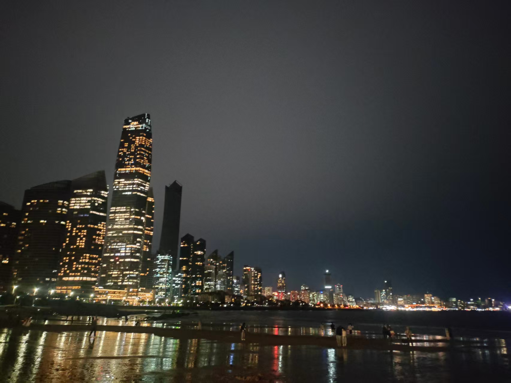

讲真的，我盯了一会题目才想起来要写
写一下吧
这个周一下午去一家做跨境MCN的公司面试，应该是黄了，没有消息了
这个周也没投简历了，现在无所谓了，实施也干了，没有什么好的岗位，就这样吧

面完试，去海边玩了玩，买了一杯瑞幸的果茶，还挺好喝

看了看青岛海边的夜景

（Ps：技术像素都一般，不嘻嘻）

书这个周也没有读，但是把之前没有整理的笔记整理了一下
我都忘了之前读到第8章了，我一直以为我读到了第四章

就这样吧，没啥要写的了

喔对，这个周把我的博客 ico更新了，说实话我的博客给访客一种莫名的压力，I think.

大概就这样

还有这个周我看了影视飓风的达芬奇教程

See you later...

在补一下，昨天我了解到他们做出海的不只是做跨境电商，独立站也不只是卖货，更多的是做工具类网站和游戏类网站。
他们的收益也不少，可以考虑一下